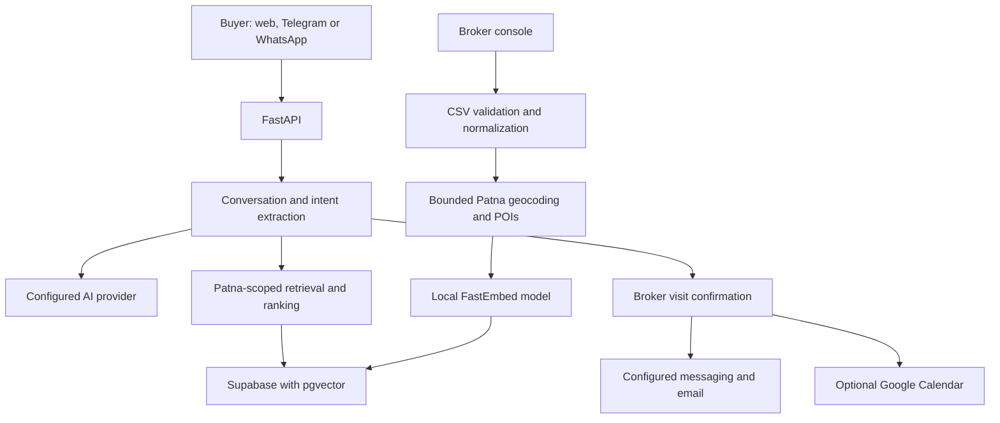

# ApnaGhar architecture — Patna

`city_config.py` defines Patna, Bihar, recognized localities, the geocoding search
envelope and `data/patna/` paths. Buyer-facing inventory queries include the active
city. Fallback retrieval broadens criteria within Patna.

Broker imports validate before geocoding and embedding. Coordinates outside the
search envelope are rejected. Successful geocoding and POI lookups are cached
under ignored `runtime/`. Missing map data remains unknown.

Run one worker. OTP and deduplication state is in process memory; reminders and
broker reply context use runtime files. Credentials stay in `.env` or deployment
secrets. The backend uses a server-only Supabase key; customer and broker access
checks run in FastAPI.

See [setup](SETUP.md), [API](API.md), and [deployment](DEPLOY.md).
